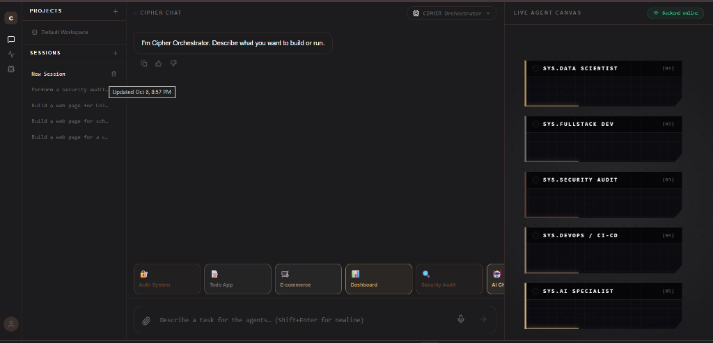
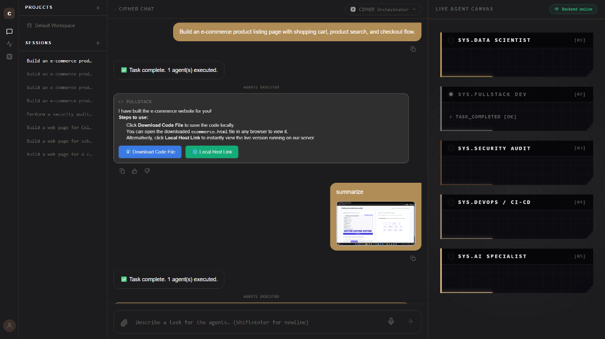
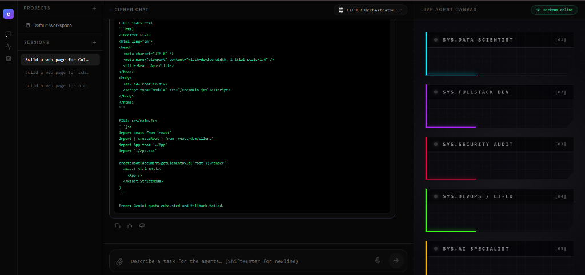

# 📸 Project Evidence & Output Showcase

Welcome to the **CIPHER Multi-Agent Autonomous Engineering Platform** outputs showcase. This document provides visual proof and execution evidence of our multi-agent system operating in real-time.

---

## 📑 Table of Contents
- [1. CIPHER Orchestrator IDE & Live Agent Canvas](#1-cipher-orchestrator-ide--live-agent-canvas)
- [2. Autonomous Task Execution & Instant Deliverables](#2-autonomous-task-execution--instant-deliverables)
- [3. Real-Time Code Synthesis & Agent Telemetry](#3-real-time-code-synthesis--agent-telemetry)

---

## 1. CIPHER Orchestrator IDE & Live Agent Canvas



### 🔍 Key Features Displayed:
* **Master Orchestrator Chat Interface**: Central conversational hub where users submit high-level, natural language software requirements.
* **Workspace & Session Management**: Sidebar for switching between historical sessions and project workspaces.
* **Rapid Action Shortcuts**: One-click quick-start modules for common enterprise workloads (**Auth System**, **Todo App**, **E-commerce**, **Analytics Dashboard**, **Security Audit**, and **AI Chat**).
* **Live Agent Canvas (Right Panel)**: Displays real-time heartbeat, execution states, and readiness status across all specialized microservice agents:
  * `[01] SYS.DATA SCIENTIST`
  * `[02] SYS.FULLSTACK DEV`
  * `[03] SYS.SECURITY AUDIT`
  * `[04] SYS.DEVOPS / CI-CD`
  * `[05] SYS.AI SPECIALIST`

---

## 2. Autonomous Task Execution & Instant Deliverables



### 🔍 Key Features Displayed:
* **Natural Language Task Routing**: The user prompted:
  > *"Build an e-commerce product listing page with shopping cart, product search, and checkout flow."*
* **Autonomous Execution & Notification**: The Orchestrator automatically decomposed the request and dispatched it to the **Fullstack Agent**.
* **Visual State Feedback**: The Live Agent Canvas dynamically updated `SYS.FULLSTACK DEV` to `TASK_COMPLETED [OK]`.
* **Actionable Artifacts**: Rather than just dumping raw text, the agent output provides:
  * Clear step-by-step instructions.
  * **⬇️ Download Code File**: Direct link to download the generated single-page code artifact.
  * **🌐 Local Host Link**: Instant one-click link to launch and review the live application running on the local server (`localhost:5173`).
* **Multimodal Inspection**: Shows follow-up image-based summarization and reasoning tasks handled in the same unified thread.

---

## 3. Real-Time Code Synthesis & Agent Telemetry



### 🔍 Key Features Displayed:
* **Full-Stack Source Code Generation**: Generation of production-structured code files (e.g., `index.html`, `src/main.jsx`, `src/App.jsx`, `src/App.css`) complete with Vite module bootstrapping.
* **Telemetry & Health Indicators**: Multi-agent status indicators (Cyan, Purple, Red, Green, Yellow) representing the active communication channels and health states across microservices.
* **Fault-Tolerant Feedback**: Resilient error capturing and status reporting streamed directly to the terminal view.

---

## 🚀 How to Run the Platform Locally

To explore this interface yourself:
1. Clone the repository:
   ```bash
   git clone https://github.com/LikhithaCB04/CIPHER-MULTIAGENT-.git
   cd CIPHER-MULTIAGENT-
   ```
2. Start the services via Docker Compose:
   ```bash
   docker-compose up --build
   ```
3. Open your browser and navigate to the frontend interface:
   ```
   http://localhost:5173
   ```
