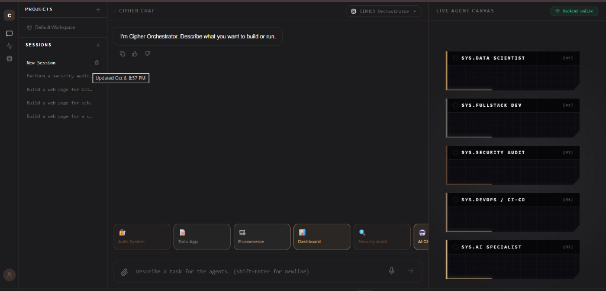
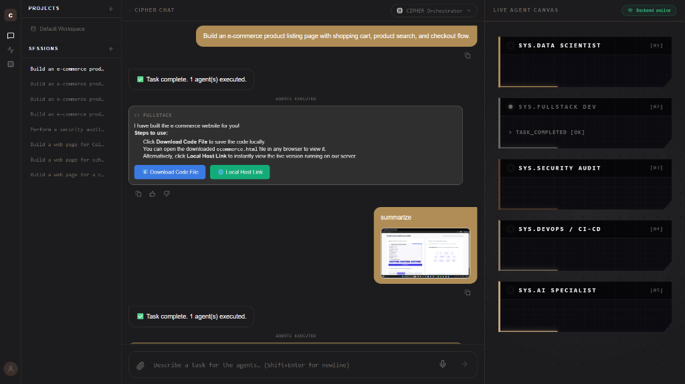

# CIPHER-MULTIAGENT-

> **CIPHER**: An Autonomous Multi-Agent Engineering & DevSecOps Platform.

CIPHER coordinates an ensemble of specialized AI agents (Data Science, Fullstack Development, Security Auditing, DevOps, and Repository Intelligence) behind an intelligent Master Orchestrator, delivering end-to-end software development with real-time UI streaming.

---

## 📸 Output & Evidence Showcase

Explore the full visual walkthrough and execution proof in **[EVIDENCE.md](EVIDENCE.md)**.

### Live Agent Canvas & Orchestrator Interface


### Autonomous Task Execution & Instant Delivery


*For more in-depth breakdowns and telemetry screenshots, see [EVIDENCE.md](EVIDENCE.md).*

---

## 🚀 Run this in GitHub Codespaces

1. Open this repository in a GitHub Codespace.
2. In the terminal, run:
   ```bash
   docker-compose up --build
   ```
3. In the Ports panel, find port 5173 for the frontend service and make it Public.
4. Open the forwarded URL for port 5173 in your browser.

The first run of `docker-compose up --build` will take several extra minutes because Docker is also pulling the Ollama models (mistral, codellama, and llama3) into the persistent `ollama_models` volume. That is expected and only happens once per Codespace.

The frontend uses the browser-facing URL `http://localhost:8000` for the orchestrator API, while the services inside Docker can still reach each other by their Compose service names when needed.